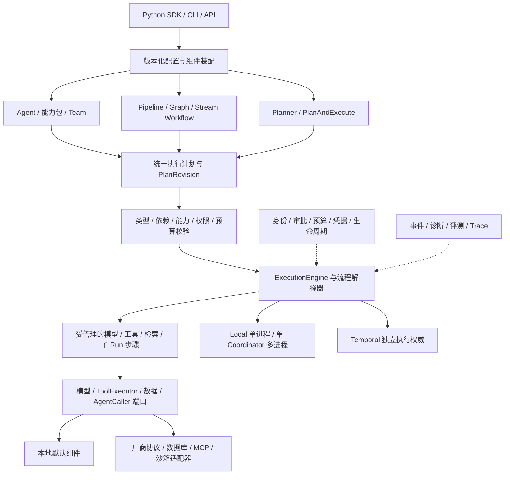

# RALF 通用框架能力与扩展验收

**真实任务追加（2026-10-29）：** 当前同包有限Single Agent／语义RAG／Plan／Team三次重复共78/78，引用、原业务写入和独立冷重连均按[本批证据](../reviews/2026-10-29-default-task-quality.md)核对。规则DAG与固定Supervisor不是自主规划质量；性能含计量开销，完整R项、外部采用与对等比较继续分开。

**当前维护范围（2026-10-29）：** 生命周期／增量流和连续应用分别按其私有制品验收；本批通过现有 Local Tool Action 补齐空 Provider 配置、可安装 async 图示例及恢复验证，见[本批记录](../reviews/2026-10-29-model-free-local-tools.md)。不增加或关闭长期 R 项，不扩 Temporal 直接 Tool、任意循环、流式数据流或企业平台。当前推荐私有包、原 Alpha 和平台资格分别见[交付状态](../../docs/implementation-status.md)。下一批仅按固定最终配置评价实际任务，历史矩阵保留原范围。

**历史校准（2026-10-23）：** 所选第三阶段含 S2 按 `8e09ec7` 原制品和环境验收；a2 已公开，原 a3 保留且发布暂停。当前独立准备包含维护契约修复和 Coding 夹具修正的 `0.1.0a4`，产品相对 `672d0cf` 仅版本赋值变化，不新增能力或执行权威。a4 的本地／平台／发布资格分别登记，不继承原包成绩；见[a4 清单](../../docs/alpha4-validation-status.md)、[实现状态](../../docs/implementation-status.md)与[剩余清单](../../docs/remaining-work.md)。下列 dev 批次及早期矩阵保留当时状态，不扩张首版范围。

Dev120 在原 History 权威内接通公共 deployment3 的既定 Temporal Coding Agent／sequence、有限图、Team／Dynamic 与递归范围，与 ordinary2 共用同地址 Registry。native grant、准确效果／费用、物理结束和独立 ACK 是不同事实，unknown 继续占位并保留恢复资料。原子事实通知、紧凑验证和 publication 优化保留原 SDK 门禁、最终完整验证及原期限；所选稳态 read-set 边界不提供即时 read-auth 撤销。范围与限制见[本批验收](../reviews/2026-10-15-temporal-deployment-coding.md)。

v30 全部12651项重新执行，11847 passed／804配置依赖跳过，独立安装416产品字节及dev119原History兼容通过；后4个测试文件的92项定向检查另记。实际安装normal原13通过／1失败保留，修订后并行关闭normal单项1 passed／152.70秒，真实故障、前后pins与unknown预期保留验证通过；两次记录不能称为同次14项全绿，也不证明原失败的精确根因。历史13拓扑与真实Docker窗口按各自冻结版本记录，结构peer不增加模型质量结论，dev109质量记录仍限原范围。公共Session S1／S2仍为下一必需项，完整R13／R01–R26与第三阶段未完成；以下旧批次段落保留其历史范围。

Dev112 沿原 Harness／Local／Temporal 权威增加固定原 CREATE 的机械监督器、两层单次 gate、真实进程与控制处理器排空，以及专用未派发证明。broker 只持有原操作，不增加业务执行权威；原 grant／attempt／未知效果保留。选定20／21与旧18／19 Worker 隔离，未选定默认保持。契约见[原 CREATE 监督](../specs/coding-create-supervision-contract.md)，实际证据及未完成范围见[本批验收](../reviews/2026-10-14-coding-create-supervision.md)。已发送请求的 daemon 负向完成、跨宿主、嵌套与复杂质量仍未验收；以下历史段落记录对应批次。

Dev110 已验收直接 Agent 成员子集：扩展显式 Temporal Coding 组合到一层 Agent Team／Dynamic；原父 History 继续拥有选择、计划修订、调度和预算，原子 Run 继续拥有 Action 与 native grant。实际成员有效授权与 Runner 背压、冻结 revision、旧 child 停止义务及 pending-only DAG patch 已实现；验收按[本批记录](../reviews/2026-10-14-temporal-coding-orchestration.md)登记。未选定默认字节保持，嵌套／sequence 成员、跨父容量与复杂真实质量仍开放。

Dev109 接通固定 Responses 模型连接、延迟解析的可替换凭证源和 Local／Temporal 显式装配，继续复用原 Action／History 执行权威。dev109 当时选定 Temporal 发布为 native protocol 2／binding 14、静态组合 version 3／binding 15；旧选定发布需要匹配的 immutable Worker。安装包真实 DeepSeek 的三类有限 POSIX Coding 任务各重复三次，通过 9/9 次、78 项独立禁网容器检查；不代表通用 Coding 质量或 AgentScope 对齐。Temporal Team／Dynamic／嵌套 Coding、跨父全局容量、跨宿主和不可确定 create／CID 窗口仍开放，完整 R13／第二阶段未关闭。 见[连接指南](../../docs/codex-model-connection.md)和[本批验收](../reviews/2026-10-14-codex-model-connection.md)。

Dev108 已验收有限 Temporal 有界静态 Agent 图 Coding：协议 13／组合版本 2，在原父 History 按有效 Runner 授权调度不同资源并行和共享资源背压；财务已结算但未证明物理结束的原子仍占槽。关闭尝试全部独立原叶、准确核对 PG／History 完整请求并重扫，失败保留资源；停止失败恢复不会重开取消中的业务。Team／Dynamic 的持久选择阶段、跨父全局 Runner 容量、嵌套／直接 Tool、专用认证和真实 Coding 质量仍开放，完整 R13／第二阶段未关闭。 见[并行指南](../../docs/temporal-parallel-coding.md)和[本批验收](../reviews/2026-10-14-temporal-parallel-coding.md)。

Dev107 已验收有限 Temporal 串行 Agent 图 Coding：显式 `coding_composition=True` 依赖原 Coding 开关，协议 12 固定原父子请求、namespace UUID 和 SDK epoch；原 History 继续管理调度、审批、结果和预算，PG 只存证据。owned 关闭排空真实 SDK 提交、关闭已有提交准入，并采纳原后代的物理停止；未知效果与整个子 cap 保留。直接 Tool／并行／Team／Dynamic／嵌套 Temporal Coding、跨宿主、专用原生认证和真实 Coding 任务质量仍开放，完整 R01–R26／R13／第二阶段未关闭；dev99 四链路保持冻结。 见[组合指南](../../docs/temporal-coding-composition.md)和[本批验收](../reviews/2026-10-14-temporal-coding-composition.md)。

Dev106 已验收原 Temporal Agent／顺序 Workflow 的有限 Coding 委托：显式 `coding_execution=True`、`tools/codex-coding-postgres` 与精确 `runner/registered-tool` 借用接通 SDK／JSON／TOML。所选发布使用 `temporal-3`／binding protocol 11／`coding_execution_protocol=1`；省略选项的默认 Local／Temporal 字节保持。原 History 独占阶段准入、结果与额度，原 PG EffectJournal 同事务记录资源意图及回执，实际 owner／原容器停止证据另行核对；关闭失败保留原资源账本供同循环重试。PG／History 原配置使用精确 readonly file bind，真实保护控制探针通过，原配置内容／inode、原 CID 移除与 History／PG 收尾已验证；此前未保护配置失败保留。复杂 Temporal Coding 仍拒绝，跨宿主、专用原生认证和真实 Coding 任务质量继续开放；固定 process-peer 协议验证不构成真实模型质量。源码全模块回归的旧协议断言已定向修订；独立安装2175项／418配置跳过、实际服务39项零跳过和旧Worker门禁已登记，完整 R01–R26／第二阶段与 dev99 冻结范围保持。见[使用指南](../../docs/temporal-coding.md)和[本批登记](../reviews/2026-10-14-temporal-coding-delegation.md)。

Dev105 将有限 Coding 委托扩展到 Local 图 Agent／直接 Tool 节点、串行／有界并行图、Team／Dynamic 和嵌套成员。复杂发布使用 `local-11`／`local-bindings-19`、`delegated_composition_protocol=1`；根级 Agent／顺序的旧路径和默认未选择工具的字节保持。原子 Run／节点 Action 继续拥有审批、额度和阶段准入；父级取消等待原后代实际停止，unknown 效果与 escrow 不因此清空。并行节点视图核对原 Run／Action／索引／资源，已排除的工具不影响调度，拥有资源关闭仍保留原权威供停止与退出回执。Temporal Coding、专用认证、真实 Coding 任务质量及完整 R01–R26／第二阶段继续开放。见[复杂组合指南](../../docs/coding-composition.md)和[本批记录](../reviews/2026-10-14-coding-local-composition.md)，dev99 冻结链路保持。

Dev104 将可选 `runner` 绑定和异步 `tools/codex-coding` 声明接入原 Local 根级 Agent／顺序 Workflow，支持一个 Profile 中多个独立 Runner、精确 `registered-tool` 借用和 owned 关闭重试。显式绑定使用 Descriptor 3／`local-bindings-18`，省略角色保留原 Descriptor 1／2 与默认发布；工具授权交集和原 Run／Action／预算／审批权威保持。具体资源在模型 I/O 前复核物理身份，owned 清理开始前隔离原 Engine，停止或关闭失败保留 Coordinator 和资源账本。图／Team／动态／嵌套与 Temporal Coding 继续拒绝，原生认证和真实 Coding 质量未验收。见[配置指南](../../docs/coding-profiles.md)和[本批记录](../reviews/2026-10-14-coding-bindings-and-profiles.md)；dev99 冻结链路不重复评测，完整 R01–R26／G1–G8／第二阶段继续开放。

dev102 新增[保留环境与共享 PG 日志](../../docs/codex-coding-environment.md)：同 container ID／generation 冷检查、保留工作区与实际整容器停止，原 EffectJournal 同事务启动意图已有有限证据，Local／PG 共用纯规则。最终受影响源码 301 项零跳过、P1／P2 已实际复验闭环，安装证据见[本批登记](../reviews/2026-10-14-codex-environment-journal.md)。原 Action／History 准入、旧启动失效、专用认证和业务 Turn 未接入，原始 argv 仍可重启；完整 G3／G5／G7／G8／R13 和第二阶段开放，dev99 保持冻结。

dev101 补齐固定候选[配置／原生控制检查](../../docs/codex-coding-preflight.md)，有限原生命令读写、路径／网络拒绝与后继整容器停止探针通过。execution_admitted=false；[原 Action 委托集成](../specs/delegated-coding-action-contract.md)、专用认证／模型 Turn 和 Local／Temporal 恢复仍待验收，R13 未完成。

dev100 开始第二阶段首个 Codex Runner 的协议／启动证据基础，见[实现边界](../../docs/codex-runner-foundation.md)。机械通信与 Journal 不拥有 Run／Action 权威；R13 完整受限 Coding 链路、Local／Temporal 版本化停止采纳和真实外部 Runner 验收仍开放。

当前交付顺序按用户修订的[阶段门槛](../../docs/delivery-gates.md)：第一阶段关闭单 Agent、语义 RAG、Plan、Team 的完整参考链路，第二阶段环境与执行，第三阶段服务化与治理。下文 R01–R26 和历史记录全部保留；新增实现必须说明阻塞哪个当前门槛，非阻塞额外适配器保留后续，不以接口或测试数量判断完成。

Dev99 四条有限 Local 参考链路的固定真实质量线已通过：单 Agent 24/24（复用 dev98 未改的业务／执行／Provider 字节），语义 RAG 24/24，Plan／Team 在关闭 JSON mode 的独立最终配置各 15/15。此前 dev98 与 dev99 JSON mode 的全部失败分别保留，不合并评分。安装后语义 CPU 应用、成员回执反馈、原取消／崩溃恢复与模型资源实释放已有证据；最终源码 8397 passed／617 配置依赖跳过，核心／SDK 安装各 254 项零跳过。四链路的安装／必要生命周期／质量／文档验证通过，随本地提交冻结第一阶段范围；这是阶段参考场景，不代表通用自主规划、完整 H3／M1／R01–R26、Temporal 部署或外部采用完成。见[阶段门槛](../../docs/delivery-gates.md)。

Dev98 自动 Facts 索引维护首期子集已验收：来源快照分代、原 Graph ToolAction、准确效果日志和 ready-only Agent 门禁；SDK／JSON／TOML、owned／borrowed 与可编辑 memory-index 模板接通原 Session／Profile 恢复。最终冻结源码 8298 passed／617 配置依赖跳过，两套安装各 163 项零跳过，12 种配置／32 个实际 Turn、六类进程窗口和旧 dev97 的 16 组 Run／Turn 双向兼容通过。349 产品模块一致，四项审查问题由同一审查者闭环。首期仅原生 SQLite／Hash；真实语义／模型质量、远程及 Temporal 维护、后台／增量物理清理／GC、两项 P3 严格输入观察、完整 R01–R26／H3／M1 和外部采用继续开放。 见[使用指南](../../docs/fact-index-maintenance.md)与[验收记录](../reviews/2026-10-13-fact-index-maintenance.md)。

Dev97 模型替换与业务组合子集已验收：固定 model-provider core P01–P10／tools P01–P16、可编辑 SQLite 供应方、SDK／JSON／TOML、同步／异步与 owned／borrowed 装配接通 Agent／当前来源 RAG／规则 DAG Plan／Supervisor Team。最终源码 8183 passed／617 配置依赖跳过；独立核心／SDK 各 205 项零跳过，修复后的安装应用共 192 种配置组合通过。六项 P2 经同一审查者闭环；实际原响应、审批效果与遗失响应窗口、旧 dev96 的 16 组 Run／Turn 双向恢复、8 类原生模型方法与默认及 K/S/Facts 字节兼容通过。345 产品模块与安装包保持一致。新返回模型证据以 128 层容器为界，超限保留完成与结算，历史已接收记录保持。未重新验收真实模型、远程服务、Temporal 或独立采用；完整 R01–R26／H3／M1、路由、索引生命周期和质量目标继续开放。 见[验收记录](../reviews/2026-10-13-model-adapter-contracts.md)。

Dev96 Facts 存储契约子集已验收：core F01–F10／managed F01–F16，独立 SQLite 替换、SDK／JSON／TOML、同步／异步装配及原提炼／受管理恢复通过。最终源码 7989 passed／617 配置依赖跳过；独立核心／SDK 各 262 项零跳过，每套安装示例完成同一应用 24 种配置组合及实际原工厂恢复。旧 dev95 的 16 组 Run／Turn 双向兼容、80 个已回收子进程、原默认／方法／K/S 字节及 342 模块一致通过。一次独立审查的三项 P2 已由同一审查者闭环，含慢速／最长及空白 namespace、历史计数与审计快照修复。本批没有重新验收真实远程服务、Temporal、模型／语义质量或独立采用；其他角色、索引生命周期、完整 R25／R01–R26／H3／M1 继续开放。 见[验收记录](../reviews/2026-10-13-facts-adapter-contracts.md)。

Dev95 Session 存储契约子集已验收：core 固定 S01–S10，receipts 固定 S01–S14；独立可编辑 SQLite 替换、同步／异步 SDK／JSON／TOML 装配及原保存恢复通过。最终源码 7727 passed／617 配置依赖跳过；独立核心安装 272 零跳过，SDK 166／1 服务配置跳过，安装示例 13 个实际命令通过。旧 dev94 默认和原 Run／Turn 的 68 个进程兼容验证、338 产品模块一致、隔离／取消及示例地址审查修复通过。本批没有重新验收真实 Temporal 服务、外部远程适配器或模型质量。严格原始非法输入、其他角色 Suite、独立采用与完整 R25／R01–R26／H3／M1 继续开放。见[验收记录](../reviews/2026-10-13-session-adapter-contracts.md)。

Dev94 已验收 R25 首个知识检索角色固定 Suite／报告、独立实现、安装后声明替换和真实本地恢复。原生 Temporal 兼容独立验证，不推广为任意外部适配器认证；Fixture 自报、离线质量或缺失 hook 不构成通过。其他角色与完整能力仍开放。见[本批验收](../reviews/2026-10-13-knowledge-adapter-contracts.md)。

Dev93 持久用户输入子集已验收：固定回复 Schema／额度、显式工具与动态 Planner、
原 Run／Turn 续接、SDK／Profile／CLI／A2A 均沿原 Local／Temporal 权威实现。
源码 7339 passed／617 配置依赖跳过，独立核心 259／SDK 277 零跳过；源码和安装
Temporal 各 12 项／24 Worker 实际等待／48 条 History 重放，六项审查修复及旧92
默认／原 Run 兼容通过。完整 H3、R01–R26、真实质量与跨框架比较继续开放。
见[本批验收](../reviews/2026-10-13-durable-user-input.md)。

Dev92 R10／H3 父级完成验证子集已验收：显式可替换policy、真实子Run／工具回执、Receipt／Inventory纯gate、受管理模型stage、Plan反馈和Team拒绝沿原Local／Temporal权威实现，提供SDK／Profile和安装后默认参考。最终源码7126 passed／605配置依赖跳过；独立核心522／SDK413零跳过，实际源码及安装Temporal各7项／各23条History重放；旧91默认及六类原Run双向兼容、旧Local／Worker业务I/O前拒绝、321产品模块一致和自有服务退出通过。一次fresh review及同一reviewer修复复验闭环五项Important，包括根Session写响应丢失后的原回执／真实结束证明恢复。原通用推荐版本1／2默认保持；真实模型质量、完整R10／H3／M1／R01–R26及外部采用继续开放。见[使用指南](../../docs/parent-completion.md)及[本批验收](../reviews/2026-10-13-parent-completion.md)。

Dev91 显式 Responses 推理续接子集已验收：保留原有序 output／密文／phase 和工具原参数，复用原 ModelContinuation／ModelHistory 与 Local／Temporal 执行权威，接通 SDK／Profile／四类评测 CLI。最终源码6792 passed／598配置依赖跳过（856.08s），独立核心安装494 passed／零跳过，实际源码Temporal5／安装Temporal17通过；311产品模块一致，旧90四类原Run及默认字节兼容。一次审查3个P2与1个CI Minor已修复，另5项公共边界回归通过；自有服务正常退出0并等待。原默认和历史发布不迁移；真实模型质量、完整R05／H3／M1／R01–R26及独立采用继续开放。见[使用指南](../../docs/responses-reasoning.md)及[本批验收](../reviews/2026-10-13-responses-reasoning.md)。

Dev90 思考模型适配子集已验收：新增显式 DeepSeekThinkingProvider／deepseek-thinking，复用原 ModelContinuation／完整历史及 Local／Temporal 执行权威，接通 SDK／Profile／四类评测 CLI。保留非思考默认和原 Run；最终源码6519 passed／593配置依赖跳过（993.63s），独立核心安装266 passed／零跳过，实际源码Temporal4／安装Temporal12通过；308产品模块一致，旧89四类原Run和默认字节兼容。唯一审查2个P2已修复；自有服务退出0并等待。真实模型质量、完整 R05／H3／M1／R01–R26及独立采用继续开放。见[接入指南](../../docs/deepseek-thinking.md)及[本批记录](../reviews/2026-10-13-deepseek-thinking.md)。

dev89跨Session原生模型历史子集已验收：最终源码6317 passed／589配置跳过（746.39s），独立核心安装243 passed／零跳过，独立安装真实Temporal76及Local/Redis/PostgreSQL50项通过。显式session/frame、每Agent继承/ref/禁用、同步/异步Profile和通用无SQL publication端口已接通；原根成功、准确CAS回执、失败候选排除及真实处理器责任保持。唯一审查4个P2及1个Minor已修复并复核；旧88四类原Run/默认字节兼容、Schema13及实际旧Worker零Activity拒绝通过。外置128轮使用明确128MiB私有服务，原50MiB服务104个已接受Turn后终止的证据保留，Continue-As-New/长期治理不据此完成。完整H3/M1/R01–R26、真实模型质量、独立采用和对等比较继续开放。见[使用指南](../../docs/model-history.md)与[本批验收](../reviews/2026-10-13-session-model-history.md)。

Dev88 完整已采纳模型历史子集已验收：最终源码6021 passed／463配置跳过（897.57s），独立核心安装368 passed／8可选SDK跳过，实际Temporal源码和安装各35项通过。新增可替换ModelHistoryPolicy/CompleteModelHistory、Local local6/Temporal joint7显式门槛、原final/签名保存、验证retry单次反馈和完整交互保护。原参数与实际默认值分离；预算不足明确失败，Artifact投影需显式许可，原参考opaque在投影前拒绝。五项Important及真实Worker未获许可读取窗口经RED统一修复；301产品模块字节一致、旧87原Run/默认兼容和三个真实Local进程恢复通过，自有服务已关闭并等待。跨Session Turn原生transcript、DeepSeek thinking/Responses reasoning、真实质量、完整H3/M1/R01–R26及外部采用继续开放。见 [使用指南](../../docs/model-history.md)与[本批验收](../reviews/2026-10-13-complete-model-history.md)。

Dev87 模型续接与 Gemini 原生函数子集已验收：最终源码5882 passed／455配置跳过（818.09s），独立核心安装295；实际Temporal源码8新恢复＋17既有场景、安装25均通过，300产品模块一致；旧86默认与同一Run双向回执／完整快照兼容通过。Local原接收／采纳与Temporal joint6两阶段保持各自唯一执行权威，签名原参数与真实默认参数分离；SDK／Profile／中间件和RAG／Plan／Team显式接通。一次独立review的2Important及重新评级的名称范围问题经RED统一修复，自有服务已正常关闭并等待退出。真实Gemini质量、其他推理续接、完整H3／M1／R01–R26及外部采用保持开放。见[模型续接](../../docs/model-continuation.md)与[本批验收](../reviews/2026-10-13-model-continuation.md)。

Dev86 端到端任务评测子集已验收：源码5681 passed／447配置跳过（830.34s）、独立核心安装161；源码三次重复RAG24/24、Plan15/15、Team15/15及安装CLI／SDK例子、旧85默认／原Plan回执兼容与298模块一致通过。复用原执行权威，新增最终模型请求可见引用、实际成员／工具回执、独立Embedding计量和观察式恢复；2项Important／1项Minor经有效RED统一修复。离线／MockTransport不构成真实模型质量；完整H3／M1／R01–R26及外部采用保持开放。见[任务评测指南](../../docs/task-evaluation.md)与[本批验收](../reviews/2026-10-13-task-evaluation-chains.md)。

Dev85 已验收子集：显式版本2推荐Plan默认使用原DAG结果依赖；完整资源声明替换无需多余Embedding配置，召回替换移除继承的互斥默认。版本1默认保持。业务／规划报告增加重复任务摘要，规划oracle与Provider前置校验、业务未完成Run恢复观察、模型兼容最终输出检查已修复。最终源码5520／447配置跳过、核心安装171、292产品模块一致和旧84原Plan回执兼容通过；独立review的1Important／1Minor均修复。整批验证以[本批记录](../reviews/2026-10-12-default-chains-evaluation.md)为准；离线回归不构成真实模型质量或完整H3/M1验收。后续段落按各dev批次保留历史证据。

Dev84 第十四类artifacts绑定子集已验收，沿原managed Context／Local／Temporal权威和真实执行所有权；支持独立Context策略与物理target／namespace、ref/disabled/inherit、默认memory／SQLite／POSIX及custom sync/async替换和owned/borrowed装配。显式disabled-only不要求额外存储；继承及legacy发布保持。

最终源码5431 passed／447配置跳过（678.60s），核心104／SDK242安装、真实源码51／安装51（均零跳过）、旧83双向兼容／22原模板／旧Worker零Activity拒绝及291模块一致通过。九类Important经一轮34项有效失败复现统一修复；本任务Temporal PID12900／session19994实际退出0并已等待，用户Docker平台保留。完整R01–R26、远端／binary／GC／cache／治理与真实质量继续开放。 见[本批验收](../reviews/2026-10-12-artifact-bindings.md)与[指南](../../docs/artifact-bindings.md)。

内容核验不等于handler-end证明，已派发未知写可nonquiescent；joint5/ref未获grant读最多耐久fence重建一次。完整H1/H3、企业治理及AgentScope全面parity未验收。dev83 M1/M2仍分别延期。

Dev83 已验收受限原生 SandboxProvider／Docker 默认、原 ToolSource、显式异步声明和每 Agent sandbox ref/disabled 授权交集。Local／Temporal 六类审批重启、已采纳恢复、原生冷接管及真实停止通过。最终源码5280 passed／418配置跳过（763.57s (0:12:43)），核心182／SDK149安装、真实源码32／安装32、旧82双向恢复／22模板／旧Worker零Activity拒绝及287模块一致通过。六项Important统一修复，M1／M2两项Minor延期；自有Temporal实际退出并等待。完整R01–R26、远程沙箱、持久工作区、Artifact传输、外部Runner和真实质量继续开放。见[原生沙箱指南](../../docs/sandbox.md)。

Dev80：纯可替换 Skill 文档解析、可选有界 YAML、固定 SKILL.md 文件目录及 skills-markdown 默认声明子集已验收。最终源码4954 passed／370配置跳过（713.55s），无YAML核心35／SDK359安装、真实源码6／安装6、旧79双向恢复／22模板／272模块一致通过。三项Important经14项RED→GREEN修复，两项Minor延期；原自有服务停止并等待。selector／异步加载／自动Context／Sandbox及完整R01–R26仍开放。见[本批记录](../reviews/2026-10-12-skill-documents.md)。

当前dev79交付每Agent Skills原工具绑定；最终源码4823／364配置跳过、核心55／SDK127安装、真实六类、旧78双向兼容／执行前拒绝及自有服务停止通过。selector／自动目录阶段与完整H4仍开放。[本批证据](../reviews/2026-10-12-skills-bindings.md)。

当前dev78交付可替换Skills目录与原受管理读工具；最终源码4757／357配置跳过、核心142／SDK204安装、真实7项、旧77兼容及自有服务停止通过。专用skills角色与完整H4仍开放。[本批证据](../reviews/2026-10-12-skills-catalog.md)。

当前dev77沿R01/R13交付受管理Workspace CAS写入、原生别名占用、DELETE＋EXTRA和普通权限保持。最终源码4615／351配置跳过，核心100／SDK214安装、实际六项、旧76兼容及自有服务停止通过。[本批证据](../reviews/2026-10-12-workspace-writes.md)保留实际原生取消窗口延期及完整能力目标。

当前dev76沿R01/R13接通第十一类只读Workspace绑定：Local／Temporal六类实际Agent使用原注册工具、固定源和权限交集。最终源码4501／345配置跳过、核心59／扩展160安装、源码及安装各六项真实服务、旧75双向恢复与Activity前拒绝、259模块一致通过；1项Important修复，1项错误分类Minor延后，自有服务停止。[本批证据](../reviews/2026-10-11-workspace-bindings.md)区分只读选择、后续写入／Skills／Sandbox／Runner，完整R01–R26仍开放。

dev72 补 R12 固定命令 JSON CLI 工具和受管理 async 装配，保留原审批／效果／实际停止边界；[本批验收](../reviews/2026-10-11-cli-tools.md)记录已通过的子集与三项延后缺口。Workspace/Skills/Sandbox 和外部 DelegatedRunner 继续作为独立能力。

dev70 提供多版本 Temporal Host；dev71 增加普通启动参数的纯预检及同一 Host 纠正重试，复用原执行权威。复杂 SDK 对象与极端数值仍有边界，完整 R04 与 R01–R26 未完成；见[dev71 记录](../reviews/2026-10-11-temporal-startup-preflight.md)。

dev67 的[Temporal 会话树](../../docs/temporal-session-trees.md)已覆盖高级根／成员保存。
dev68 增加[Context 实际读取生命周期](../../docs/temporal-context-read-lifetime.md)，
原 History 统一响应与实际结束门禁；[子集验收](../reviews/2026-10-11-temporal-context-read-lifetime.md)已通过。完整 Temporal 配置／恢复路由、
其他环境角色、治理、真实质量及完整 R01–R26 保持开放。

Dev46 已增加[Temporal 自动记忆与五类 Agent 绑定](../../docs/temporal-memory-bindings.md)：显式 temporal-3、原声明子树、History 选择响应／CAS／核验与父子证据恢复；旧发布保持。其他 Temporal 绑定角色／资源 selector、共享 Session、语义质量与完整 H1/H3 仍待验收。

文档版本：1.8；日期：2026-10-11（Asia/Shanghai）。
作者：RALF 项目维护者与架构协作。
读者：框架维护者、应用开发者、适配器贡献者。
状态：目标架构与交付要求。下表保留 dev9 设计基线；dev10–dev13 已交付静态图、MCP/Tool、本地并行和异步装配。dev14 增加有界规划/子 Run 团队及真实 Redis/PG/Qdrant；dev15 已增加DAG/嵌套、本地与真实Redis消息交接、A2A0.3轮询子集及独立Temporal Agent/sequence后端，dev16 已增加异步 A2A 控制、共享 PG Inbox／Outbox 和单机服务模板；dev17 通过显式扩展发布交付 Temporal Graph/Team/Dynamic/嵌套与注册 RAG、每任务执行策略和业务评测入口；dev18 已交付独立 Parser／Chunker 和原子知识摄取回执；dev19 增加显式 HTTP Embedding 和可组合 Hybrid／融合重排；企业治理、实时流和真实模型质量仍需验收。其他后端能力不默认为可用。当前范围见[实现清单](../../docs/implementation-status.md)、[编排指南](../../docs/orchestration.md)和[数据指南](../../docs/remote-data.md)。其余目标不构成已支持声明。

Dev45 已交付 Local 图／并行／Team／动态／嵌套实际 Agent 的受管理规则／模型字段选择记忆和推荐默认组合；原节点／子 Run 保留来源与额度，显式终态根 resume 只恢复已结束子 Run 的证据，不新增派发。dev45 时 Temporal 自动记忆尚未交付；dev46 已接通写入与五类绑定，完整 H3 质量仍待验收，见[高级记忆契约](../../docs/composite-memory-stages.md)。

当前分层剩余能力及验收见[当前剩余清单](../../docs/remaining-work.md)：dev20–dev30 已增加显式上下文／产物、来源记忆提炼／模型摘要、Temporal 纯自定义上下文、Responses/typed工具、中间件／事件、共享采纳规则及 H1a/Local H1b/Session H1c/Facts与Knowledge范围H1d及纯完成Verifier H1e／执行限制H1f绑定；dev31 增加 Local stateless 入口，dev32 增加同库原生／顺序 Session/Turn 与 idle rebind；dev33 增加 Temporal 原生／顺序共同入口。dev34–39 已交付高级 Temporal 入口及同库／远程复合会话；dev40–43 已交付 Local 原生／顺序自动记忆、历史摘要、推荐组合与有来源引用／产物投影。下面 dev9 矩阵保持历史基线，不作为当前未实现清单。

Dev47 提供[显式语义知识、相关事实召回与 Plan／Team 起步组合](../../docs/h3-intelligent-combinations.md)，复用原受管理阶段和唯一执行权威；旧版本 1 Profile／ManagedDataContext 身份保持。词项相关排序只覆盖有界候选，完整 H3 质量尚未验收。

Dev48 新增[显式 HTTP 重排](../../docs/http-reranking.md)，沿既有 AsyncReranker／原知识权威完成来源前后校验及 owned 异步装配；不改变旧排序和默认组合。检索准备不是持久化模型 Action，不保证付费调用恰好一次或计费上限。

## 1. 目标与达标定义

RALF 的目标是通用 Agent 框架：个人开发者用默认组件完成单 Agent、知识问答与工作流，业务团队通过替换组件和组合流程满足需求，企业沿同一套定义扩展到独立服务、隔离执行与分布式部署。审批与业务效果恢复是贯穿框架的能力；项目范围同时包含模型、工具、Agent、多 Agent、编排、上下文、记忆、RAG、配置、数据与运维。

每个基础能力必须有**公共行为契约、可运行默认实现、独立替换入口和共同验收**。完成接口定义只算“已定义”；默认组件跑通、另一实现替换成功、真实服务验证分别记录。业务代码不依赖具体数据库客户端或模型协议。配置选择和 Python 注入使用同一组件注册机制。

开箱即用按三个层次验收：核心安装无需 Redis、PostgreSQL、Temporal 或向量服务，可运行本地 Agent／Workflow／词法 RAG；真实模型和网络工具显式配置服务与凭据即可使用；企业组合提供可部署配置、迁移及恢复说明。离线 Provider 验证执行链路，不能作为模型任务质量证明。需要服务或下载模型的能力必须说明依赖，不在安装或首次启动时隐式调用收费服务、下载大模型。

本设计补充[总架构](../design.md)，不取代[实现清单](../../docs/implementation-status.md)或[M1 验收门槛](../../docs/m1-acceptance.md)。新增契约名均为设计名称，除明确标为“已交付”的端口外，不能当作当前可导入的 SDK API。

## AgentHarness目标整合（dev24之后）

[AgentHarness目标架构](harness-runtime.md)把本文的逻辑能力整合为按Agent可组合的运行系统。
广义Harness包含Core；现有Harness/NativeHarness保留为纯DecisionPolicy。
每Agent绑定、统一Agent/Session入口、受管理默认链路、Workspace/Sandbox与Service按H1–H5推进，
具体首期输入、作用域、版本和兼容规则见[绑定契约](../specs/agent-capability-binding-contract.md)。
[Facade/Session契约](../specs/agent-facade-session-contract.md)补齐H2前置行为：Runtime独立托管执行、wait仅观察、首期耐久busy拒绝、绑定CAS修订及owned/borrowed关闭。队列是后续独立能力；远程客户端关闭不关闭Workers。命名与本地AgentScope源码取舍见[修订记录](../reviews/2026-10-08-agent-harness-facade.md)。
dev25交付H1a，dev26交付[Local H1b绑定](../../docs/agent-bindings.md)，同一六类选择与Profile v2覆盖原生Agent/顺序/图/Team/动态DAG/嵌套成员；dev27交付Local Session后端/namespace/实际地址占用；dev31 增加 Local stateless Agent/Runtime、独立托管与观察／关闭子集；dev32 增加[同库原生／顺序 Session H2b1](../../docs/session-api.md)。dev33 增加[Temporal 原生入口 H2c1](../../docs/temporal-agent-api.md)。dev34 接通已注册高级 Temporal 入口。dev35–39 已交付同库／远程复合会话；dev40–43 增加 Local 原生／顺序自动记忆、历史摘要及推荐数据上下文。dev44扩展高级Local及Temporal自动历史压缩与产物卸载（原执行权威分阶段证据）。dev46 已补五类 Temporal 绑定及自动记忆写阶段；其他角色资源选择、环境角色及完整 H2/H3 仍待实现。原有数据角色、计划、授权和恢复契约继续有效。

## 2. 分层及公共边界

这是逻辑组件图，不要求每层单独部署。核心领域对象和纯解释逻辑不导入数据库驱动、Broker SDK 或模型厂商 SDK。适配器依赖领域契约，核心通过装配取得组件。维持公共 facade；随模块增长拆分内部包时，保留公共导入路径和弃用说明。

公共契约共同规定以下行为，而不强制每个组件实现全部能力：

1. 输入输出为有限、可校验的数据或有类型的产物引用；跨进程传递注册名称与版本，不序列化活连接、闭包或任意可执行对象。
2. 组件身份包含适配器版本和影响行为的配置；凭据使用引用。运行固定首次解析的 Release，新默认配置只作用于新任务。
3. 能力描述区分工具调用、流式、取消、恢复、分页、事务、TTL、隔离和一致性。缺少必需能力在执行前拒绝，不能以静默降级宣称兼容。
4. 错误、超时、未知效果与重试责任明确。外部 SDK 隐式重试必须关闭或声明；授权结果、审批及预算由可信运行时采纳。
5. 生命周期说明资源归属、线程／事件循环亲和性、启动、排空和关闭。目标增加异步资源生命周期协议；保留现有 `close()` 契约的兼容桥，不能以调用方取消推定真实 handler 已退出。
6. 纯同步策略负责确定性变换；模型规划、摘要、检索、远程调用等异步 I/O 进入受管理步骤，持久记录输入与结果。扩大能力时不把 I/O 塞入现有纯 `Harness` 或 `ContextBuilder`。

## 3. 默认实现与替换矩阵

下表的“默认目标”是完整通用 SDK 的要求；此表为 dev9 历史设计基线，不能据其缺口判断当前 SDK。当前 ArtifactStore/AsyncArtifactStore、memory/SQLite/file JSON 默认和受管理卸载已经交付；dev84独立绑定候选状态见本文开头及[当前实现清单](../../docs/implementation-status.md)。“可选适配”列列出建设范围，不表示这些组合已经支持。不同职责可使用同一数据库，但接口和权威仍然分开。

| 层／能力 | 公共边界 | 默认目标 | 可选适配／自定义 | dev9 证据与缺口 |
| --- | --- | --- | --- | --- |
| 模型 | ModelProvider；可选流式、预检、能力与原生续接协议 | 文本／工具 Provider、格式、生成参数和原生历史 | 国内外原生协议、兼容协议、本地推理、多模态、路由分期 | Chat/Anthropic/Gemini函数与DeepSeek思考、无状态Responses已交付；dev91原生Responses推理配置／恢复子集已验收，线上质量继续开放 |
| Agent | AgentSpec＋Harness；目标增加受管理策略组合 | 通用模型／工具循环；Search／RAG 能力包 | 业务指令／工具／Schema、策略及 Coding Runner | 默认循环与纯 Harness 已交付；规划、Coding、Realtime 不是现成 Agent |
| Workflow | 目标 WorkflowCompiler／Validator／Interpreter | 顺序 Pipeline、静态 Graph、类型化节点 | 自定义节点、条件、合并、受限循环、子流程 | 当前只有固定顺序 Agent 步骤 |
| 动态规划 | 目标 Planner → PlanProposal → PlanRevision | 受限 ModelPlanner；离线 RulePlanner 验证链路 | 业务 Planner、Verifier、重规划策略 | 未交付；现有 RecallPlanner 只选择记忆查询 |
| 多 Agent | 目标 AgentCaller／TeamStrategy | Sequential、Router、Supervisor／Workers | 团队策略、远程 A2A、模型选择、子任务拆分 | 未交付；不同 AgentSpec 不等于协作协议 |
| 工具定义与注册 | ToolSpec／ToolRegistry | 简化 Python 声明、Schema 推导、查询／发现 | 显式 Schema、业务工具、工具包 | 注册及 Schema 已交付；便利入口和常用工具包待补 |
| 工具执行 | ToolExecutor＋DispatchEnvelope | PythonToolExecutor；受控 HTTP／CLI／MCP 接入 | 外部执行器、回执查询、SandboxBackend | 可信 Python、MCP stdio 和固定命令 JSON CLI 子集已交付；MCP HTTP、通用 HTTP、外部 Runner、沙箱未交付 |
| 上下文 | ContextBuilder；目标 TokenCounter／ContextPolicy | 预算装配、完整工具组裁剪、引用、大结果卸载 | tokenizer、摘要、上下文注入策略 | 字符预算与快照已交付；Token、摘要和卸载待补 |
| 短期记忆 | SessionStore／AsyncSessionStore；分页召回 | SQLite、内存 Session，去重／CAS／分页 | Redis、PostgreSQL、外部会话服务 | 本地实现已交付；外部适配器未交付 |
| 长期记忆 | LongTermMemoryStore／异步及召回端口 | SQLite 显式事实；可选提炼、冲突确认 | PostgreSQL／Redis Facts、外部记忆系统 | 本地事实／TTL／CAS 已交付；自动提炼未交付 |
| 原始知识 | KnowledgeStore／KnowledgeContextPort | SQLite 文档、版本、来源及删除 | PostgreSQL、业务知识库、连接器 | 内存／SQLite 与来源校验已交付；连接器／ACL 目录待补 |
| 文档摄入 | DocumentParser／Chunker／IngestionKnowledgeStore | UTF-8 文本／Markdown、HTML／DOCX 正文及可选文本 PDF、兼容字符／可选段落分块、原子知识回执 | PDF OCR／布局与兼容语料、其他 Office、网页、业务 API、Token／语义分块 | dev18 D1 已交付；向量索引显式独立，后台连接器仍待补 |
| Embedding | EmbeddingProvider | 配置即用的 Embeddings API 适配器；可选本地模型 | 厂商原生协议、sentence-transformers 等独立扩展 | 只有可注入端口，没有内置 Provider |
| 向量索引 | VectorIndex | 内存／SQLite 精确检索；企业 pgvector | Qdrant；其他后端按贡献逐项验证 | 本地 cosine 已交付；外部向量库和 ANN 待补 |
| 检索与重排 | Retriever；目标 Reranker／RetrievalPipeline | 词法检索；向量检索、混合融合、默认保序重排 | 业务 Retriever、交叉编码器／模型 Reranker | 词法与注入式向量检索已交付；混合、重排待补 |
| 记忆策略 | 召回策略；目标 MemoryExtractor／MemoryPolicy | 显式写入、确定性召回；提炼需显式启用 | 模型提炼、保留／遗忘／冲突策略 | RecallPlanner 已交付；模型提炼与自动遗忘待补 |
| 工作流状态 | 目标 WorkflowStateStore／Reducer | 版本化状态、不可变节点输入、显式 reducer | 业务 reducer、共享只读知识／结果 | 无通用图状态或黑板；记忆库不能替代它 |
| 产物与缓存 | 目标 ArtifactStore／CacheStore／CachePolicy | 本地不可变内容；默认关闭可选缓存 | S3 兼容存储、Redis 缓存 | 尚无完整公共端口和默认实现；不得缓存授权决定代替复核 |
| 消息传输 | 目标 MessageBus／Inbox／Outbox | 有界进程内投递，耐久交接另行保存 | Redis Streams、RabbitMQ；其他 Broker 按契约接入 | 未交付；Broker 不拥有 Run 状态 |
| 流式工作流 | 目标 StreamChannel／CheckpointStore | 有界本地数据流、显式消费与检查点 | 持久流服务、业务数据源／Sink | 未交付；模型 SSE 不等于数据流编排 |
| 执行权威 | ExecutionEngine／ExecutionStore／CoordinatorLease | Local 单进程＋SQLite | 单 Coordinator 多进程；Temporal 多主机 | 单进程已交付；更换 Store 不等于多进程／分布式 |
| 治理 | 当前本地 policy；目标 Policy／Approval／Credential／Budget 端口 | 本地 owner、持久审批、拒绝默认、执行额度 | 企业身份、资源授权、凭据服务、金额预算 | 本地协议已交付；企业身份、期限和通用治理端口待补 |
| 配置与装配 | RuntimeProfile／Catalog／ComponentRegistry／Builder | JSON／TOML、Python 注入、版本固定、默认装配 | 自定义工厂、配置来源、显式迁移 | 已交付本地版本路由；无监听、代码归档或热迁移 |
| 观察与评测 | RunEvent／Diagnostics；目标 EventStream／Telemetry／EvalSuite | CLI 诊断、离线报告、可复现任务集 | OTel、业务评分、API／Web UI | 持久事件及离线报告已交付；服务流式、OTel、真实质量基线待补 |

“每层都有默认实现”不意味着默认启动所有组件。例如关闭缓存、显式长期记忆、词法 RAG 都是有定义的默认行为；模型提炼和语义检索启用后必须有实际可配置实现。不得用假向量或脚本回复证明语义能力。

## 4. 三种静态编排与动态 Plan

### 4.1 统一计划，多个定义入口

Pipeline 表达顺序结果传递；Graph 表达依赖、条件、扇出／合并和受限循环；Stream Workflow 表达逐条数据传递。它们通过编译与校验形成共同的类型化计划，保留节点、边、状态、端口、结束条件、资源和计划版本。数据流节点附加通道与检查点描述，不将数据流硬塞进“整步结束后传一个结果”的语义。

节点类型目标包含 Agent、Tool、Transform、Retrieve、HumanInput／Approval、Subworkflow／ChildRun、Planner 和 Verifier。自定义执行节点通过版本化 NodeExecutor 注册；执行引擎沿用审批、Action、预算及结果采纳，纯 Transform 保持确定性。初期明确限制可用节点类型，逐项扩大能力；不能先开放任意可执行配置再补恢复语义。

WorkflowCompiler 负责声明转换，Validator 负责引用、Schema、依赖、循环上限和能力检查，Interpreter 只根据计划及已采纳结果判断可执行节点。调度／持久提交由 Engine 完成；不同执行后端复用纯判断逻辑和行为契约，不共享第二套执行权威。旧顺序 Workflow 使用兼容编译入口；计划及执行 Schema 升级必须有显式版本处理，不能直接让新解释器推进旧 Run。

节点输入使用显式结果引用／字段映射，校验来源、类型和缺失值；失败、跳过、等待和取消各有状态。稳定节点 ID、循环迭代及子调用身份确定逻辑 Action，Attempt 变化不改变业务效果身份。节点状态和结果引用随执行权威提交，WorkflowStateStore 的业务状态端口不形成另一套调度日志。

静态 Graph 默认所有必需依赖完成后调度。分支记录选择结果；未选择节点为 skipped。合并显式声明 all-required、first-success、quorum 和 reducer，处理部分结果、失败及晚到结果。循环具备迭代上限、预算与终止条件。并行以不可变输入和有限额度运行，不能凭 asyncio Task 结束释放仍活跃调用的容量或资源。

### 4.2 流式编排的三个独立交付项

| 流式能力 | 数据与完成含义 | 恢复要求 |
| --- | --- | --- |
| 模型 token 流 | 临时文本片段；完整响应才形成模型决策 | dev9 已交付完整 SSE 收集；片段不作为执行事实 |
| Run 事件订阅 | 带 Run／sequence／cursor 的状态事件 | 根据耐久事件续订、去重、游标过期及终态说明；服务接口待交付 |
| 节点数据流 | 带 channel／record_id／sequence／Schema 的记录、结束及失败标记 | 消费位置、算子状态、检查点、重放与 Sink 效果共同定义；待交付 |

数据流默认采用有界缓冲和生产者背压；有最大记录数／字节数、超时及取消策略。Checkpoint 固定输入消费位置、输出提交位置与算子版本。可重放来源和持久记录支持从检查点恢复；不可重放来源明确标记恢复限制。默认至少一次处理，写 Sink 使用稳定效果身份／下游幂等或核验；收到记录或 Broker ack 不代表业务效果已确认。多输入合流显式声明顺序、窗口与终止条件，不承诺跨源全局顺序。

### 4.3 Plan → Execute → Verify → Replan

动态 Planner 是受管理的执行阶段：提交模型请求或调用业务规划器，保存收到的计划提案，确定性校验通过后提交 PlanRevision，再执行节点。Verifier 根据已记录结果给出完成／失败／需重规划证据；重规划有次数、时间、预算、可选节点及权限上限。RulePlanner 为离线链路提供真实规则规划；ModelPlanner 需实际配置模型，另行评测规划质量。

Planner 只能引用已注册能力，不能通过提案扩大权限、伪造执行结果或批准工具。计划更新使用 revision／CAS，默认仅修改尚未派发的节点；已确认效果不可重写，已有 Attempt 与未知效果继续追踪。改变审批相关操作使对应批准失效。重放消费保存的提案和版本，不重新询问模型。现有 RecallPlanner 与任务 Planner 名称及职责保持分离。

## 5. Agent 与多 Agent 的组合

应用定制分三层：修改 AgentSpec 的目标、模型、工具与输出；注入 Harness／上下文／记忆／工具组件；用 Workflow、Planner、TeamStrategy 组合执行策略。常用能力包是这些公共组件的组合，不另起持久化或审批循环。General、Search／RAG、PlanAndExecute 和 Coding 各有最小 starter 与能力清单；外部 Codex／Claude／DeepSeek Runner 通过独立能力契约接入。

AgentCaller 负责创建及观察子 Run，携带稳定调用 ID、父子关系、收窄 Scope、共享预算账户引用、剩余 deadline 和取消策略。TeamStrategy 只提出委派及汇总方案；Engine 提交并推进。默认提供顺序团队、显式路由、Supervisor／Workers，再扩展 Debate／Critic 和远程 A2A。广播讨论与任务调用可组合，但不能把普通消息当作子任务完成回执。

并行成员使用独立 Session 和不可变上下文；共享知识为有范围的只读检索，共享写状态使用版本／CAS 与明确 reducer。父任务取消按声明传播到子任务，仍活跃的子任务／效果继续占有资源并可观察。成员失败、部分结果、合并策略、最大层级／成员数及总预算均可配置。MessageBus 负责投递，可靠 Inbox／Outbox 负责交接；保持唯一的 Run 执行权威。

## 6. 数据、工具与上下文的完整链路

### 6.1 存储角色与远程适配

| 记录职责 | 本地目标／已交付基础 | 远程目标 | 必须验证的语义 |
| --- | --- | --- | --- |
| Run／Action／命令／效果／额度 | SQLite 执行日志已交付 | Temporal History；PG 控制／效果日志 | 原子采纳、命令去重、额度预留、执行归属；不可仅复制 SQL 方法 |
| 短期 Session | SQLite／内存已交付 | Redis、PostgreSQL | 消息去重、CAS、分页高水位、范围、断线和关闭 |
| 长期 Facts | SQLite／内存已交付 | PostgreSQL、Redis | 版本冲突、TTL、删除、召回／有效性、明确数据保留策略 |
| 原始文档与 Chunk | SQLite／内存已交付 | PostgreSQL／外部知识源 | 原始来源权威、版本、删除与授权；分块策略独立 |
| 派生向量索引 | SQLite／内存已交付 | pgvector、Qdrant | 维度、模型／分块身份、过滤、删除、来源回读、索引延迟 |
| 产物／检索缓存／投递 | 本地文件／可选缓存／进程内 Bus 待补 | S3／Redis／Redis Streams、RabbitMQ | 引用提交、孤儿清理、TTL、Inbox／Outbox、背压 |

Redis 的会话、缓存和消息适配器分别声明持久性／保留设置；不因服务名相同就默认具有执行日志的可靠性。PostgreSQL 适配器使用其原子事务／CAS 能力；远程数据库不自动带来多 Coordinator。Temporal 后端拥有独立 Workflow／History 执行权威，PG Run 投影仅用于查询。现有同步 ExecutionStore v1 要求事务方法；未来异步数据接口按版本设计桥接，不能偷偷用阻塞客户端包装异步名义。

本地适配器、远程适配器都必须验证角色契约和生命周期。发布矩阵先维护 SQLite、本地内存、Redis Session、PG Facts／Knowledge、pgvector／Qdrant 这几条参考组合，再按贡献扩大；无需先维护所有角色与所有数据库的笛卡尔积。

### 6.2 RAG 与记忆策略

摄入链路为 Connector → Parser → Chunker → 原始知识提交 → Embedding → 派生索引；查询链路为 QueryTransform → Retriever → Fusion／Reranker → 来源回读与授权／版本检查 → Context。各个策略有可替换入口和简单默认：文本解析、字符分块、原查询、词法检索、确定性融合及保序重排。高级组件启用后记录自身版本和成本，不把保序重排当作语义相关性模型。

Embedding 的维度、模型版本、归一化和 Chunker 身份进入索引身份；变更触发显式重建／迁移，不能混用向量。知识删除和撤权立即影响来源有效性，索引及缓存的延迟不允许绕过执行前检查。连接器游标、摄入去重、错误记录、后台任务、重建和删除传播构成完整生命周期。默认词法链路可无模型运行；向量链路提供可配置 API 和独立可选本地模型实现。

短期记忆保存会话，长期记忆保存确认事实，RAG 保存外部知识。自动提炼单独产生带来源、可信度和冲突状态的候选事实；经过 MemoryPolicy 接受后写入长期存储。摘要、提炼、语义召回有自己的受管理模型／检索步骤与用量，不能藏在同步读取方法中。

上下文治理先计算模型可接受的输入预算，预留输出，按优先级装配固定指令、完整工具组、近期消息、事实和知识。TokenCounter 说明 tokenizer／估算边界；摘要保留原消息引用和事实保留评测，大结果写 ArtifactStore 后传受控引用。最终实际请求快照与来源证据继续持久化。

### 6.3 工具接入及沙箱

工具便利 API 根据 Python 类型／注释推导 Schema，仍允许显式 Schema、效果分类、授权与核验覆盖；推导不改变执行许可。HTTP 默认固定目标和参数映射；CLI 默认固定 executable 与 argv，不隐式经过 shell；MCP 负责协议发现、Schema、版本与 Session 生命周期。三者统一生成 ToolSpec，并由 ToolExecutor 接收已授权的 DispatchEnvelope。

SandboxBackend 独立管理本地受控进程、容器及远程执行环境，声明网络、文件、资源、停止与恢复能力。普通子进程不是安全沙箱。MCP／CLI 后端停止失败、断连或写效果未知按能力进入核验／等待状态，不能被包装成已完成或盲目重发。Coding Workspace 和有状态浏览器使用资源租约，避免并行节点相互修改。

## 7. 扩展开发体验与共同验收

普通使用者选择已验证组件，只需要改配置；适配器作者实现角色契约并注册工厂，完成验收后应用同样通过配置接入。高级执行后端的原子性和归属责任仍需框架作者证明，由模板、参考实现和测试套件降低接入成本。配置不自动加载任意代码；插件安装与激活分开，激活阶段做兼容检查。

每个组件交付包同时提供 Protocol／Schema、默认实现、配置示例、Python 注入示例、生命周期说明、契约测试和失败诊断。目标 AdapterContractSuite 按角色组合范围／CAS／去重／TTL／分页／取消／关闭／恢复测试；本地替身测试和真实 Redis／PG／向量服务集成证据分别保存。身份相同但实际后端变化、错误返回、断线重试和关闭失败都是必测场景。

| 使用者任务 | 可验收结果 |
| --- | --- |
| 首次安装 | 从 wheel 独立运行 Agent、顺序／图 Workflow、RAG starter；不依赖仓库 examples |
| 换模型 | 只改模型声明或注册 Provider；无能力时获得定位明确的预检错误；验证工具调用与使用量 |
| 接自己的工具 | 简单声明即运行；需要审批的写操作仍可跨重启恢复，不手工编写内部 Action 记录 |
| 换 Session／Facts／向量库 | 独立替换组件，Agent／Workflow 业务定义不改；错误、范围和分页契约通过 |
| 自定义流程与规划 | 注册节点／Planner／TeamStrategy 后复用同一引擎；不复制审批、预算或恢复代码 |
| 排障及升级 | 查看配置身份、计划／节点、等待原因、未知效果和修复命令；保留旧版本并显式迁移 |

首用时间、接入代码量、定制步骤和独立完成率通过外部开发者实测冻结目标；不将维护者熟悉项目后的演示时间作为证据。图 starter 和首个 KnowledgeRetriever 套件已交付；其他角色套件及上表的完整验收尚未完成。

## 8. 建设顺序与里程碑

通用 SDK 和企业运行时分开推进，复用已验证契约。M1 的故障、真实模型、首用及最小 Temporal 门槛继续保留；新增本地能力可以进入后续预览，不以这些未完成门槛宣称 M1 已验收，也不把本地图、规划和团队功能全部推迟到完整 Temporal 之后。

| 增量 | 实现范围与依赖 | 交付验收 |
| --- | --- | --- |
| G1：静态编排基础 | 先提供版本化计划、编译／校验／解释边界，兼容顺序入口；图依赖、条件、输出映射；先单进程调度 | 独立 Graph starter，自定义节点替换；分支／等待重启不重复已确认节点；旧 Run 版本拒绝／续跑明确 |
| G2：工具与本地并行 | 简化工具声明、HTTP／MCP／CLI、资源生命周期；图扇出／合并、有界并发和共享状态规则 | 默认工具包和接入教程；审批、取消、真实线程归属、未知效果及并行合并证据 |
| G3：规划与多 Agent | G1／G2 基础上增加 ChildRun／预算、Planner／Verifier／PlanRevision、Router／Supervisor／Workers | 离线规则和真实模型两套任务；受限重规划、团队部分失败、取消传播、父子恢复 |
| G4：完整智能数据链路 | 独立 Chunker／Parser、默认 Embedding、Token 上下文、卸载／可选摘要、提炼与混合重排；Redis／PG／向量适配 | 词法／向量 RAG starter；真实远程服务套件、删除／TTL／迁移、事实与引用质量。数据组件可在 G1–G3 期间独立交付 |
| G5：流式编排与外部 Runner | 耐久事件订阅、StreamChannel／检查点／背压；Codex 等独立 Runner 能力验收 | 可重放数据源和幂等 Sink 的恢复样例；明确非重放源限制；外部 Runner 的审批／取消／恢复证据 |
| G6：企业运行模式 | 单 Coordinator 多进程、独立 Temporal、可靠 MQ／A2A、API／控制台、OIDC、运维治理 | 同一业务定义多模式验收；容量、迁移、数据清理、备份、停机／恢复演练 |

dev10 已完成 G1 的计划、串行静态图、纯变换和可替换编译／解释边界，保留旧入口兼容桥；通用异步自定义节点及实际并行继续在受管理执行器增量交付。G1 不把“定义多个节点”标作“已实现多 Agent 协作”。工具及外部数据适配器按各自共同测试交付；每次发行都更新能力矩阵。

### dev14 的实际 G3/G4 状态

| 项目 | 已交付与替换方式 | 仍需验收 |
| --- | --- | --- |
| G3 规划内核 | DynamicWorkflowSpec、Planner/PlanVerifier、提案接收/修订采纳窗口、Rule/Model Planner、受限重规划；原生 Agent 子调用复用执行权威 | 模型规划质量、异步模型 Verifier、动态 DAG/嵌套流程与时间额度 |
| G3 团队内核 | TeamSpec/TeamStrategy、Sequential/Router/Supervisor 默认、独立 Session、父子 escrow/取消/恢复；JSON/TOML 与 Plan/Team starter | 外部开发者采用、递归团队、远程 A2A/MQ 与企业授权 |
| G4 远程适配 | Redis Session/Facts；PG Session/Facts/Knowledge；Qdrant 派生索引；abuild 默认工厂、实际服务测试和权威来源回读 | pgvector、版本/Cluster/failover/性能矩阵、迁移/清理、语义 embedding/混合重排、独立 Parser/Chunker 与智能记忆链路 |

这些是可运行的参考实现与扩展入口，G3/G4 完整目标尚未验收。默认 HashEmbeddingProvider 是词项散列基线；规则/fixture ModelPlanner 只验证执行契约。数据服务与父子并发仍位于单 Local Coordinator 范围。审查、兼容和安装证据见[dev14 记录](../reviews/2026-10-07-data-orchestration.md)。

## 9. AgentScope 对标及超越证据

本次对标冻结为 AgentScope **v2.0.9，提交 `2e706a6`**，资料核对日 2026-10-06。该版已有 Goal／Team Pipeline，Team 由 leader 委派并发成员；SOP 的持久恢复仍标记实验性。[官方 Pipeline 导出](https://raw.githubusercontent.com/agentscope-ai/agentscope/v2.0.9/src/agentscope/pipeline/__init__.py)、[版本发布说明](https://github.com/agentscope-ai/agentscope/releases/tag/v2.0.9)

官方 SDK／服务能力包括多厂商模型、MCP 工具、上下文整理、记忆接入、RAG、沙箱和应用服务；对标范围覆盖这些链路的实际可用性。官方功能描述用于建立实验清单，不替代 RALF 团队的使用与故障测试。[固定版本 README](https://github.com/agentscope-ai/agentscope/blob/v2.0.9/README.md)

| 比较维度 | 达到目标的证据 | 可以提出“超过”的条件 |
| --- | --- | --- |
| 能力与默认实现 | 本文矩阵的基础 Agent／编排／数据／工具链路有可运行入口，并注明各自支持范围 | 补充场景确有更完整行为；不能以端口名数量判断 |
| 定制与适配 | 外部开发者独立换模型、工具、数据后端、节点、团队策略；公开接入代码与耗时 | 同任务接入成本更低且保持相同要求，有重复用户实验 |
| 任务质量 | 相同模型版本、工具、数据、预算和评分器；报告任务成功、参数、拒绝、停止、引用与规划质量 | 事前冻结阈值和样本量，报告不确定性，不能只挑成功例 |
| 恢复可靠性 | 审批重启、提交后崩溃、重复控制请求、未知效果、来源失效、取消竞争通过 | 对等配置下公开更好的故障结果与实现代价；说明下游幂等／核验前提 |
| 性能与运维 | 单／多进程／分布式分别测延迟、吞吐、费用、内存、清理、迁移及恢复 | 固定环境、并发与质量要求后，给出可复现提升 |

Realtime、TTS 等高级多模态，以及公网持续群聊在当前正式版范围外，单独标记未覆盖。若这些差异仍在，就限定为“目标业务链路达到”而不宣称全能力替代。当前 dev9 的默认链路和适配覆盖尚未达到该基线；本文没有执行跨框架 benchmark，也没有优越性结论。LangGraph 的可靠执行对照继续使用[M1 的独立协议](../../docs/m1-acceptance.md)。

## 10. 决策与后续实现入口

本文确定：每层组件的四项交付要求、统一计划与多种编排入口、异步智能步骤与纯策略分离、数据角色独立、多 Agent 通过子 Run 复用执行权威，以及通用 SDK 先行的建设顺序。对应不变量见[领域与状态契约](../design.md#4-领域对象请求与状态契约)、[数据权威](../design.md#92-每类记录的唯一权威)和[扩展发布](../design.md#13-发布兼容与开发体验)。

具体实现时为 G1–G6 各自建立版本化规格、兼容计划和验收记录；原有[Run 命令](../specs/run-command-contract.md)、[Action 恢复](../specs/action-recovery-contract.md)、[Runner 能力](../specs/runner-capability-contract.md)继续作为约束。当前端口与装配方法见[执行组件](../../docs/execution-components.md)、[运行装配](../../docs/runtime-assembly.md)、[模型接入](../../docs/model-adapters.md)、[记忆／RAG](../../docs/recall-and-rag.md)。

## dev17 分布式边界

独立 Parent Workflow 记录提案、修订、子调用身份与额度，实际 Child Workflow 仍拥有模型／工具执行事实；控制、选择和上下文为独立 Activity。策略注册、KnowledgeContext 与 TemporalExecutionPolicy 可以替换和配置，扩展发布和原生发布区分。详见[分布式编排](../../docs/temporal-composition.md)。这扩展 G3／G4／G6 的已交付部分，不代表 M1 或企业阶段验收完成。

## 智能数据链路的下一轮设计

[组件设计草案](intelligent-data-pipeline.md)把 Parser／Chunker、语义 Embedding／混合重排、上下文预算／卸载、摘要／长期记忆提炼与业务 Verifier 的端口、默认实现、恢复及验收要求集中说明。D1 的独立 Parser／Chunker／原子摄取已实现；D2 的协议／Hybrid／融合重排已实现，真实语义质量及 D3–D4 尚未验收，当前交付能力仍以实现清单为准。

Dev49 [Query transform／语义 Facts 召回](../../docs/query-and-semantic-recall.md)沿原检索与记忆端口组合，确定性默认和语义有序上下文均可替换；来源与已接受的引用快照仍由原权威管理。语义召回限候选窗口，Temporal仅 Query Knowledge 端口；不增加持久向量／自由记忆修订或第三套运行状态机。

Dev50 [ModelQueryTransform](../../docs/model-query-transform.md)以已有 ModelProvider 提出有界搜索词，原 Retriever／Facts 后端接受并验证来源；JSON/TOML 显式命名模型、借用生命周期与每 Agent 数据绑定复用原装配。默认不开启收费改写；已接受 Run/History 快照可恢复，接受前准备仍可能重复。自动策略、全库索引和真实质量未完成。

Dev51 在 R16 增加[HTML 解析适配与摄取模板](../../docs/html-ingestion.md)，沿原 DocumentParser／原子知识回执保持来源、分块和恢复；默认文本解析仍兼容。HTML 是归一化文本提取，不是 CSS／DOM 渲染或展示清洗，网页连接器和完整知识生命周期仍待交付。

Dev52 延续 R16/H3 增加[DOCX 正文解析](../../docs/docx-ingestion.md)，通过原 DocumentParser 接入，不增加新存储接口或执行权威；段落／表格文本与原始来源回执可恢复。Word 排版、图片与完整 Office 兼容仍未实现。

Dev53 在 R16 增加[可选文本 PDF 适配](../../docs/pdf-ingestion.md)，仍复用原解析／分块与原子知识回执。OCR／版面还原和真实 PDF 兼容语料仍待验收。

## dev60 当前入口增量

[Temporal History Sessions](../../docs/temporal-sessions.md) 接通实际 Namespace UUID、耐久 Turn／busy／CAS，覆盖原生／顺序／高级组合及普通／managed 上下文。Session 协调不拥有业务 Action；外置 Session 数据、其余角色、FIFO／续接／迁移及完整 H2/H3 仍未完成。当前能力以剩余清单和逐批验收为准。

## dev61 Temporal 限制策略

R01/H1f 在原 History 接通可替换 LimitsPolicy、宿主交集、逐节点固定和整批超限拒绝；绑定支持七类。纯策略 Activity 不拥有执行权威，恢复复用原 caps。见[指南](../../docs/temporal-agent-limits.md)；全局容量、其他角色和完整 H1/H3/M1 未完成。

Dev62 接通 [Temporal 纯完成验证](../../docs/temporal-completion-verification.md)，原 History 采纳当前节点回执的 accept/reject/retry，再进入记忆或节点完成。Temporal 八类角色包括 verifier；DecisionPolicy、外置 Session、环境角色及完整智能质量仍待验收。

### dev63 Temporal DecisionPolicy

DecisionPolicy 复用公共纯 Harness prepare/propose。固定 host/ref/inherit 选择、identity及两个实际方法、原请求/响应/提案证据，原 History 校验并采纳；必需角色disabled拒绝。实际准备工具只能是原描述的无重复子集，mandatory Schema／权限／审批／限制保持。只支持编译器零参数super闭包及可验证Python基类方法，不允许直接类访问或其他opaque捕获。默认无额外策略的旧发布保持；源代码/解释器变更保留原Worker，不宣称跨版本指纹相等。九类绑定当前已包含decision_policy，外置Session、环境角色和完整H1/H2继续开放。见[指南](../../docs/temporal-decision-policy.md)。

### dev64 默认 Session 数据核验前置

内存/SQLite 增加精确 scoped message receipt，同步与异步端口共用结果契约；Local 独立数据复用原保存恢复，同库默认保持。完整 Temporal 外置数据责任见[目标规格](../specs/temporal-session-data-contract.md)，原 Run/Parent 承担数据完成门禁，Session Coordinator 保留占用/静默责任。规格与 SPI 不构成 Temporal 第十类绑定或完整 H1/H2/H3 交付。

### dev65 Temporal 固定 Session 数据读（依赖子集）

[有界读指南](../../docs/temporal-session-data-reads.md)接通 stateless 原生／顺序的 host 与每 Agent session inherit/ref/disabled、宿主 namespace、原始端口／客户端／物理资源固定。普通及 managed Context 将原 Scope、Run/node 私有地址、页、revision 和来源引用交给原 History 采纳；重放使用已接受证据。PostgreSQL 显式 initialize 固定解析后的 table schema。
这只是完整外置 Session 的读取依赖；不保存最终答案，不提供跨 Run Conversation。显式 History Session 与选中外置数据的高级组合（含嵌套模型 Planner）接受前拒绝。外置 CAS 写／原完成门禁、持久 SessionKey／跨 Turn 成员路径、Profile 组合与租约仍须按原目标交付。完整 H1/H2/H3/M1、R01–R26 和真实质量门槛继续开放。

## dev69 Temporal 声明装配

TemporalProfile／Catalog 与 TemporalRuntimeBuilder 复用现有组件端口、十类绑定和原执行权威；Assembly 只持有真实 SDK 调用／线程／生命周期，不推进业务状态。关闭保留原 end Update 接收责任，等待真实工作再释放资源。默认未配置 Profile 的发布／请求格式保持兼容；新的显式配置与安装模块见[指南](../../docs/temporal-profiles.md)，最终证据见[验收](../reviews/2026-10-11-temporal-profile-assembly.md)。完整配置、环境角色、长期治理与质量继续开放。

## dev70 Temporal 多版本 Host（子集验收通过）

沿 R04/H1/H5，TemporalProfileHost 只组合原 Assembly 与 Facade，不创建第三套业务状态。全 Catalog 固定和纯预检先于 I/O；原 Registry/Coordinator 队列需保留，默认选择不迁移旧 Run/Session。可信 Scope、实际 namespace UUID、原 Manifest 与版本均参与重连验证。所有版本实际调用、桥接线程和原结束通知排空后，才停止所有 Worker 并清理共享 owned ledger。借用 SDK Client 不清理。配置现在可声明既有 PostgreSQL EffectJournal；Local 与旧 dev69 拒绝该新声明。

见[指南](../../docs/temporal-profiles.md)及[验收](../reviews/2026-10-11-temporal-profile-host.md)。本子集最终全量／安装／兼容门槛通过；完整 R01–R26、其余环境角色、部署版本／迁移、容量／保留、企业身份及真实质量继续开放。

Dev73沿R12增加[固定目标HTTP JSON工具](../../docs/http-tools.md)和CLI完整起步；共享有限JSON采纳与原Policy/实际线程，保留执行权威；[最终验收](../reviews/2026-10-11-fixed-business-tools.md)通过，完整目标仍开放。

Dev74沿原MCPTransport提供[HTTP JSON／POST SSE](../../docs/mcp-http.md)，保持原Action、效果核验和真实线程归属。[子集验收](../reviews/2026-10-11-mcp-http.md)通过；持久Session/OAuth/GET恢复仍开放。

## dev75 只读Workspace（子集验收通过）

沿原工具接入可替换WorkspacePort／POSIX文件／内存默认实现，有界路径与可信Scope、实际线程／FD拥有和原结果恢复。[指南](../../docs/workspace.md)／[子集验收](../reviews/2026-10-11-workspace-read.md)通过；Agent.workspace角色、写入租约、Skills／Sandbox／Runner和完整H4仍开放。

## Dev111 物理资源边界

沿原 Harness／Local／Temporal 执行权威增加同根容量一、原 invocation 等待与持久原义务；create 回复丢失只查询／校验／停止原 CID，不重授执行。新选定18／19与旧16／17 Worker隔离。规则与验收见[契约](../specs/coding-root-capacity-contract.md)和[本批记录](../reviews/2026-10-14-coding-root-capacity.md)。负向 create 屏障、CLI监督、持久排队、跨宿主、嵌套及复杂质量继续开放，不能用子集验收关闭完整 R13。
