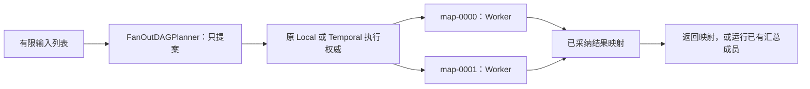

# 有界列表分发与汇总

2026-11-10 开发源码在 `aa77b90` 基线上增加显式 `FanOutDAGPlanner`：把非空列表的每项交给已有 Worker 成员，按输入索引收集结果，或者交给一个已有汇总成员。本批按有限范围完成源码、准确安装及所选真实服务验收，准确候选和实际结果见[验收记录](../architecture/reviews/2026-11-10-fan-out-planning.md)与[当前交付](current-delivery.md)；原推荐组合、Alpha 和此前私有包不自动包含此能力。

Planner 只提出原 DAG。Local／Temporal 继续使用各自原来的父子 Run、审批、预算、回执、取消和恢复协议，不建立新的调度器或业务重试循环。



## 先运行完整离线示例

[fan_out_workflow.py](../examples/fan_out_workflow.py) 使用普通异步组件计算每项平方，再汇总已完成结果。它包含审批、关闭重开、重复命令和独立 SQLite 调用／回执审计，不调用模型或网络。数学运算是只读操作，审计账本不代表任意外部业务写的恰好一次保证。

先安装包含本批实现的 SDK，再从对应源码或 sdist 取得示例。wheel 不包含 `examples/`；脚本保存为原文件名 `fan_out_workflow.py` 后可在 checkout 外执行：

```sh
FAN_OUT_DEMO_DIR="$(mktemp -d)"
cp examples/fan_out_workflow.py "$FAN_OUT_DEMO_DIR/"
cd "$FAN_OUT_DEMO_DIR"
python fan_out_workflow.py --db runs.sqlite --command-id batch-001 --pause-before-approval
python fan_out_workflow.py --db runs.sqlite --command-id batch-001
python fan_out_workflow.py --db runs.sqlite --command-id batch-001
```

第一条在审批处暂停，业务请求数为0。第二条沿原数据库恢复并审批，最终结果为：

```json
{
  "keys": ["map-0000", "map-0001", "map-0002"],
  "values": [9, 1, 4],
  "total": 14
}
```

第三条找回原 Run 和回执，`requests_this_process` 应为0，累计 Worker／汇总请求为4；原成功结果与预算不重新执行。准确验证结果仍以本批验收为准。执行库旁的 `runs.sqlite.business.sqlite` 是示例自己的审计库，不承担框架执行权威。

保留原脚本文件名、代码、组件 identity、定义、Profile、Scope 与两个数据库用于恢复。相同 command_id 必须保持原输入和配置；新业务操作使用新命令身份，更改代码／配置时保留匹配原任务的版本。不要通过重命名应用模块或改参数绕过原恢复检查。

## 不需要模型的 SDK 最小组合

下面使用默认 identity 节点，直接复制每项有限 JSON。它在临时目录创建 SQLite，结束后清理；要跨进程恢复请改用明确保留的数据库路径。

```python
import asyncio
import json
from pathlib import Path
from tempfile import TemporaryDirectory

from relf_agent import (
    DynamicWorkflowSpec,
    GraphNode,
    GraphWorkflowSpec,
    RuntimeBuilder,
    RuntimeProfile,
    ValueRef,
)


async def main():
    profile = RuntimeProfile(
        "batch",
        "1",
        providers={},
        components={
            "workflow_executors": {"adapter": "identity", "config": {}},
            "planners": {
                "adapter": "fan-out",
                "config": {"worker": "item", "max_items": 4},
            },
        },
    )
    member = GraphWorkflowSpec(
        "copy-item",
        [GraphNode("copy", executor="identity")],
        output=ValueRef("copy"),
    )
    batch = DynamicWorkflowSpec(
        "copy-batch",
        {"item": member},
        planner="fan-out",
        plan_mode="dag",
        child_budget=1,
        max_steps=4,
        max_revisions=1,
        max_concurrency=2,
        max_depth=3,
    )
    with TemporaryDirectory(prefix="relf-fan-out-") as directory:
        with RuntimeBuilder().build(profile, Path(directory) / "runs.sqlite") as runtime:
            handle = runtime.submit(
                batch, ["alpha", {"n": 2}, None], command_id="batch-001", budget=3
            )
            done = await runtime.drive(handle.run_id)
            assert done.state == "succeeded"
            print(json.dumps(done.result, ensure_ascii=False))


if __name__ == "__main__":
    asyncio.run(main())
```

输出是 JSON 对象，键与原输入索引对应：

```json
{"map-0000": "alpha", "map-0001": {"n": 2}, "map-0002": null}
```

它不是完成顺序数组。即使后面的任务先结束，`map-0000` 仍对应输入第0项。应用需要数组时可按这些稳定索引键转换，或让显式汇总成员生成自己声明的输出。

`providers={}` 需要同时显式配置受管理节点；identity 工厂只接受空 config。换成自己的 Worker／汇总组件时，沿用[受管理异步节点](managed-async-nodes.md)的结构化端口、注册 Schema 和资源所有权，不需要继承新的 Agent 基类。Agent 成员仍需要原 Provider 与该执行后端已有的组合支持。

## Planner 参数与限额

```python
from relf_agent import FanOutDAGPlanner

planner = FanOutDAGPlanner(
    "item",
    reducer="summary",
    items_path=("payload", "records"),
    max_items=16,
    version="1",
)
# LocalEngine(..., planners={"fan-out": planner})
# DynamicWorkflowSpec(..., planner="fan-out", plan_mode="dag")
```

| 参数 | 约定 |
| --- | --- |
| `worker` | 默认 `"worker"`，必须是该定义已注册的成员 alias |
| `reducer` | 默认 None；配置时须为已注册成员；也可复用 Worker alias，但其输入 Schema 须同时支持单项和结果映射 |
| `items_path` | 默认空路径，输入本身须为非空列表；字符串取对象字段，非负整数取列表元素；最多31段，为最终项索引保留一段 |
| `max_items` | 默认32；严格整数，无汇总时1..256，有汇总时1..255；不截断超量输入 |
| `version` | 默认 `"1"`，非空字符串，与完整不可变配置一起进入组件身份 |

汇总成员接收 `{"map-0000": 已采纳结果, ...}`，依赖所有 Worker 完成，最终返回该汇总成员的结果。它是原受管理成员，不是可并发写入的共享状态 reducer。审批等待、失败、取消或未知效果不能作为成功结果提前汇总。

`max_items` 只计算 Worker 数；`DynamicWorkflowSpec.max_steps` 以及宿主的 `remaining_steps`／`max_nodes` 还必须包含可选汇总节点。例如32项加汇总需要至少33个步骤。并发受原 `max_concurrency` 约束，子预算仍按原 `child_budget` 预留；原作用域授权、审批与实际调用额度也继续生效。

空列表、缺失路径、非列表输入、缺成员或超过任一原限额会明确拒绝，不自动变成成功的空计划。只接受原 `PlanningRequest` 的初始整数 revision=0、空结果列表；不自动重规划已经接受的子任务。原显式 pending-node patch 是宿主能力，不由这个 Planner 发起。此实现不提供循环、任意共享 reducer 或逐记录流式 Workflow。

## JSON／TOML 显式装配

SDK 的 `planners={"fan-out": FanOutDAGPlanner(...)}` 与 `components.planners` 的工厂声明等价。仅注册可用工厂不会把策略加入 Local／Temporal 默认 planner 表；未选择时保持旧默认组合。

把下列内容保存为 `batch.toml`，即可替换上面 SDK 示例中的 Profile：

```toml
schema_version = 1
[default]
name = "batch"
version = "1"

[[profiles]]
name = "batch"
version = "1"
providers = {}

[profiles.components.workflow_executors]
adapter = "identity"
config = {}

[profiles.components.planners]
adapter = "fan-out"
[profiles.components.planners.config]
worker = "item"
items_path = []
max_items = 4
version = "1"
```

```python
from relf_agent import load_catalog

profile = load_catalog("batch.toml").default
```

JSON 使用相同的 Catalog 和组件结构；例如上述 `planners` 声明对应：

```json
{"adapter": "fan-out", "config": {"worker": "item", "items_path": [], "max_items": 4, "version": "1"}}
```

定义中的 `planner="fan-out"`、成员 alias 与 Profile 必须匹配。同步／异步装配沿原[Runtime 配置](runtime-assembly.md)和[客户端生命周期](async-assembly.md)；Planner 工厂本身不创建客户端或 owned 资源。

Temporal 使用原 `TemporalProfile`／`TemporalRuntimeBuilder.abuild`，Catalog 顶层需 `kind="temporal-profiles"`，详见[Temporal Profile](temporal-profiles.md)。它复用同一显式 Planner，执行仍归原 Parent History。本页无模型 Graph 组合遵守[Temporal 受管理节点](temporal-managed-nodes.md)已有的无 Session／Turn、Coding 等限制，不扩大后端组合范围。

同一冻结源码与准确隔离安装分别在真实本机 Temporal Service 上通过2项：原父子 Run 与稳定结果映射，以及审批暂停后 Worker 重启、原命令恢复；没有 time skipping 或外部模型调用。原始证据为 `dist/fan-out-20261110/service/source-preflight/pytest.xml`、`dist/fan-out-20261110/service/source-preflight/pytest.log`、`dist/fan-out-20261110/service/source-preflight/result.json`和`dist/fan-out-20261110/service/source-preflight-inputs.json`。源码预检的1588份执行输入与最终冻结逐项相同；安装证据另存 `dist/fan-out-20261110/service/installed-final/`，两轮同ID各2/2通过。完整范围和审核见验收记录；只覆盖审批静止窗口的Worker重启，不授予活跃物理处理器全冷恢复或未运行的平台资格。指南首个Python块及完整示例也已在checkout外、仅运行依赖环境原文执行通过；包内文档保留构建时快照，最终成绩以独立验收为准。

原包、原失败、推荐组合与历史质量成绩分别保留，本批不推送或公开发布。与其他框架的差距及后续范围见[当前对齐说明](../architecture/reviews/2026-11-10-framework-alignment.md)，不据此关闭完整 R01–R26 或宣称对等任务质量。
